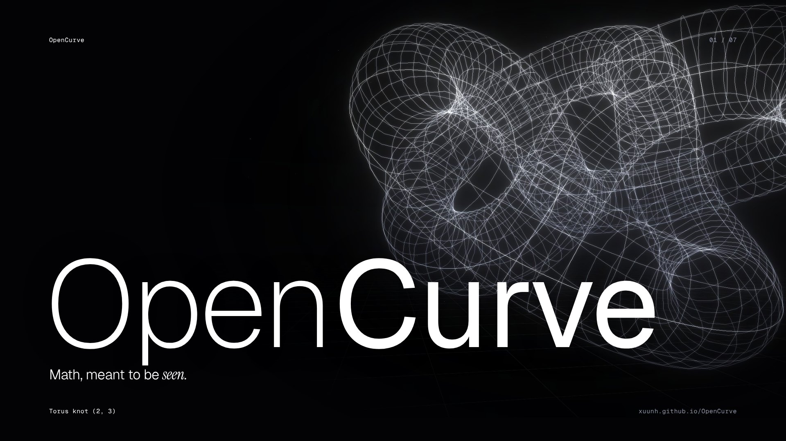
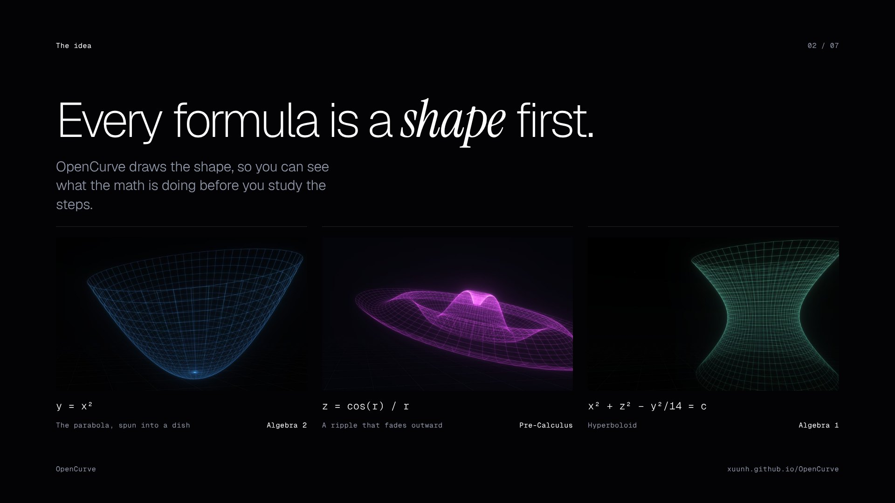
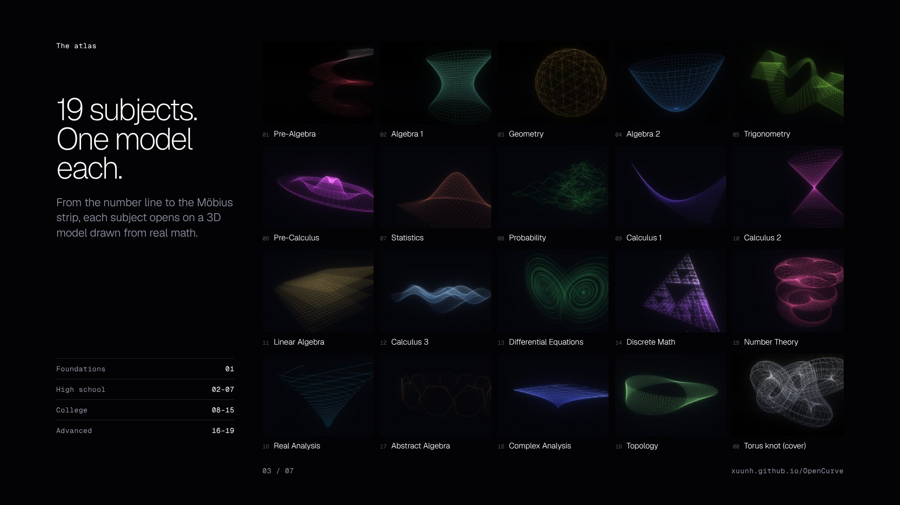

# OpenCurve

Math, meant to be seen. Every subject from Pre-Algebra to Topology, drawn as a glowing 3D model.

**Live site:** https://xuunh.github.io/OpenCurve/



## What it is

OpenCurve is a place to look at math before you study it. It is not a textbook, and it doesn't try to teach everything. Each subject gets a 3D model drawn from real equations, so you can see the shape of an idea (how a curve behaves, what a limit approaches, how a surface bends) before the formulas.

It's made for students, tutors, and teachers, and it's built to run on laptops, Chromebooks, and classroom projectors.



## How to use it

- **Scroll** (or Space, Page Down, the arrow keys, or the ↑ ↓ buttons) to move one subject at a time
- **Move your mouse** to tilt the view
- **Index** at the top of the screen jumps to any subject

## Subjects



| # | Subject | Model | Status |
|---|---|---|---|
| 01 | Pre-Algebra | The number line, wound into a spiral | Planned |
| 02 | Algebra 1 | Hyperboloid x² + z² − y²/14 = c | In progress |
| 03 | Geometry | Geodesic sphere | Planned |
| 04 | Algebra 2 | The parabola y = x², spun into a dish | In progress |
| 05 | Trigonometry | Sine wrapped on a circle, y = sin 5θ | Planned |
| 06 | Pre-Calculus | Ripple z = cos(r) / r | In progress |
| 07 | Statistics | Bivariate normal distribution | Planned |
| 08 | Probability | Branching random walks | Planned |
| 09 | Calculus 1 | Tangent lines of y = x², swept into a surface | Planned |
| 10 | Calculus 2 | Double cone x² + z² = y² | Planned |
| 11 | Linear Algebra | Planes under a shear | Planned |
| 12 | Calculus 3 | z = sin x · cos y | Planned |
| 13 | Differential Equations | Lorenz system | Planned |
| 14 | Discrete Math | Sierpinski pyramid | Planned |
| 15 | Number Theory | Times tables on a clock, n → kn (mod 120) | Planned |
| 16 | Real Analysis | A sequence converging to its limit | Planned |
| 17 | Abstract Algebra | Symmetry group of the hexagon | Planned |
| 18 | Complex Analysis | Conformal map w = z² | Planned |
| 19 | Topology | Möbius strip | Planned |

The cover model is the torus knot (2, 3). Topics inside each subject are being added one at a time, starting with Algebra 1, Algebra 2, and Pre-Calculus.

## Slides

A short overview deck for proposals, presentations, or sharing. Free to use with credit.

- [OpenCurve-overview.pdf](assets/slides/OpenCurve-overview.pdf) (7 slides)
- Single images in [assets/slides](assets/slides), including a 1280×640 link preview

## Run it locally

The whole site is one file, `index.html`, with no build step. Open it in a browser, or serve the folder:

```
python3 -m http.server
```

Then go to http://localhost:8000.

## Built with

- [Three.js](https://threejs.org) r128 for the 3D models and the bloom glow
- [Geist and Geist Mono](https://vercel.com/font) by Vercel, and [Instrument Serif](https://fonts.google.com/specimen/Instrument+Serif), loaded from Google Fonts
- Plain HTML, CSS, and JavaScript, hosted on GitHub Pages

## Contributing

Found a math mistake, want a topic, or want to help build? See [CONTRIBUTING.md](CONTRIBUTING.md), or [open an issue](https://github.com/xuunh/OpenCurve/issues/new/choose).

## Credits

Made by Junayed Haider ([@xuunh](https://github.com/xuunh)), Biomedical Engineering student at The City College of New York.

## License

MIT. See [LICENSE](LICENSE).
